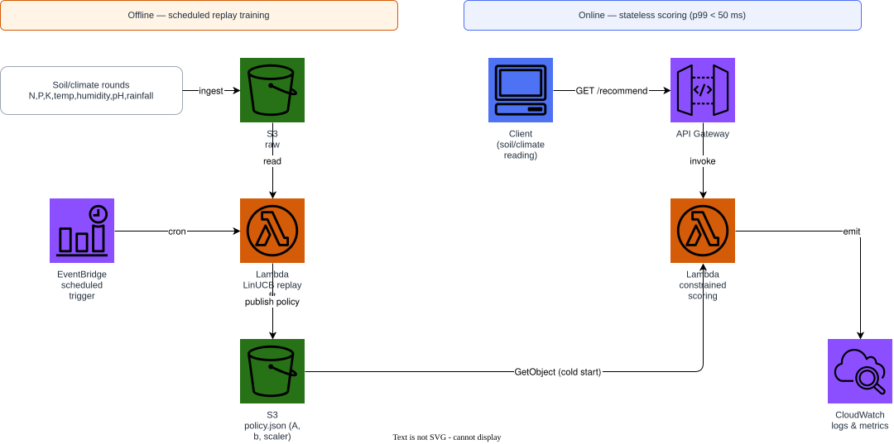
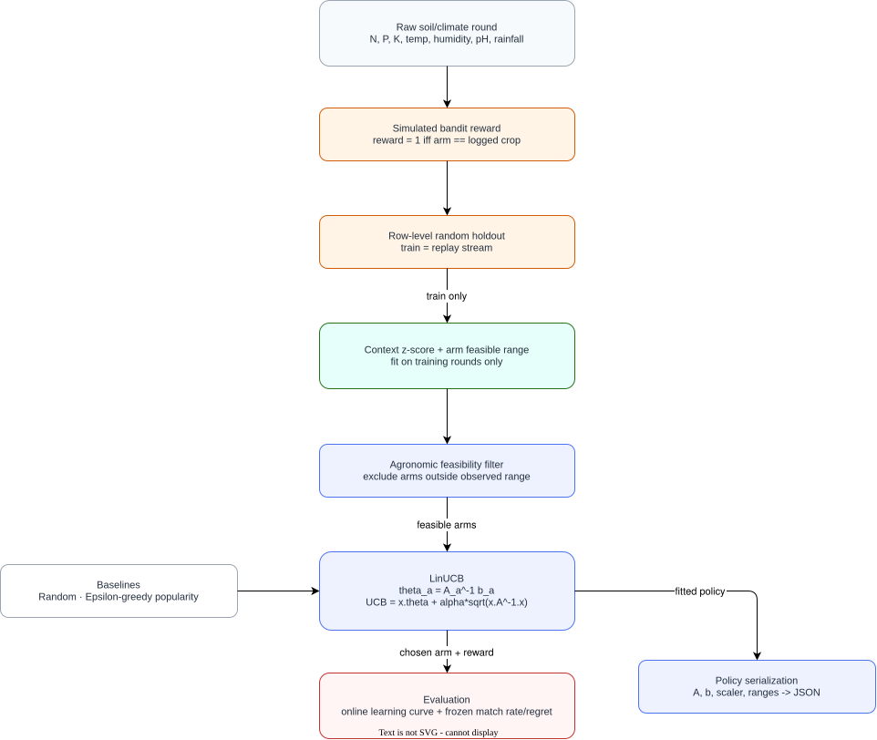

# Crop Contextual Bandit Recommender

A **constrained LinUCB** contextual bandit for crop recommendation from
soil and climate readings. No neural network, no gradient descent: LinUCB
is a disjoint linear model with a closed-form ridge-regression update per
arm, and the "constrained" part is a hard agronomic feasibility filter
built directly from training data — not learned, not a neural layer.

---

## Why a bandit, not a classifier

Crop recommendation is usually treated as multi-class classification. This
project instead frames it as the realistic deployment setting: one
decision per request, made from a single observed context, with feedback
only on the action actually taken. Each row of the source dataset becomes
one simulated bandit round (context = soil/climate vector, reward = 1 iff
the chosen crop matches the logged one), which is the standard way to
replay a labelled dataset as an offline bandit log.

The **agronomic constraint** restricts the arm set LinUCB is allowed to
choose from at each round to crops whose training-time observed
(N, P, K, temperature, humidity, pH, rainfall) range contains the current
context. This is both a safety mechanism (never recommend a crop that is
agronomically implausible for the given conditions) and — as the paper
shows — a large accelerant of online learning.

---

## Dataset

[Crop Recommendation Dataset](https://www.kaggle.com/datasets/atharvaingle/crop-recommendation-dataset)
(Kaggle ref `atharvaingle/crop-recommendation-dataset`): soil nutrient
levels (N, P, K), temperature, humidity, pH, and rainfall, each row
labelled with an agronomist-recommended crop across 22 crop types.

---

## Quick start

```bash
python -m venv .venv && source .venv/bin/activate
pip install -e ".[dev]"

# Synthetic fixture with the same schema (no Kaggle account needed)
python scripts/download_data.py --synthetic

# Build the context scaler and the agronomic constraint table
python scripts/build_features.py

# Train (online replay), evaluate, recommend
python -m recommender.cli train
python -m recommender.cli evaluate
python -m recommender.cli recommend --N 90 --P 40 --K 40 --temperature 24 --humidity 82 --ph 6.5 --rainfall 230
```

The real dataset (requires `KAGGLE_USERNAME`/`KAGGLE_KEY`):

```bash
python scripts/download_data.py --kaggle
```

---

## Architecture

### AWS deployment



### Recommendation flow



Both diagrams are editable: [`docs/aws-architecture.drawio`](docs/aws-architecture.drawio)
and [`docs/recommendation-architecture.drawio`](docs/recommendation-architecture.drawio).
Regenerate them with `scripts/generate_diagrams.py`.

Unlike the per-user top-N portfolio projects, there is no DynamoDB table
here: every request carries its own context, so the serving Lambda reads a
single small serialized policy (per-arm matrices, scaler, constraint
ranges) from S3 at cold start and scores in memory.

---

## Models

| Model | Mechanism | Notes |
|---|---|---|
| `ConstrainedLinUCB` | LinUCB restricted to the agronomic feasible arm set | The main contribution |
| `LinUCB` | Plain disjoint LinUCB over all arms | Isolates the constraint's effect |
| `EpsilonGreedy` | Non-contextual, frequency-weighted exploration | Context-blind baseline |
| `Random` | Uniform over feasible arms | Sanity-check floor |

---

## Feature engineering

Features are declared in [`conf/features.yaml`](conf/features.yaml) and
fitted strictly on the training replay stream — never on validation/test
rounds.

| Feature | Family | Fit scope |
|---|---|---|
| `context_zscore` | context | train_only |
| `arm_feasible_range` | item | train_only |
| `arm_popularity` | item | train_only |
| `arm_context_centroid` | item | train_only |

`tests/test_features_leakage.py` asserts the scaler and the constraint
table are unaffected by corrupting held-out rounds. `tests/test_features_parity.py`
asserts the serialized policy served by the Lambda handler recommends
exactly the arm the in-process, live policy would choose.

---

## Evaluation

Rounds are shuffled once into training (70%, replayed as the online
learning stream), validation (15%) and test (15%). Two protocols are
reported:

**Held-out generalisation** (policy frozen, test partition):

| Model | Match rate | Regret | Mean candidate pool |
|---|---:|---:|---:|
| ConstrainedLinUCB | 0.9556 | 0.0444 | 1.73 |
| LinUCB | 0.9926 | 0.0074 | 8.00 |
| Random | 0.8519 | 0.1481 | 1.73 |
| EpsilonGreedy | 0.9185 | 0.0815 | 1.73 |

**Online learning curve** (mean reward during training itself):

| Model | First 25 rounds | First 100 rounds | All rounds |
|---|---:|---:|---:|
| ConstrainedLinUCB | 1.00 | 0.96 | 0.978 |
| LinUCB | 0.20 | 0.40 | 0.870 |

The constraint sharply reduces exploration cost (near-perfect reward from
round one, versus plain LinUCB needing the whole training stream to catch
up) at a small, honest cost: constrained LinUCB's held-out match rate is
marginally *below* plain LinUCB's, because a hard feasibility filter
occasionally excludes the true crop when a test context happens to fall
just outside its own crop's observed training range. Both the benefit and
the cost are reported — see [`paper/main.pdf`](paper/main.pdf) for the full
discussion.

---

## Infrastructure

```bash
docker compose up -d
terraform -chdir=terraform init
terraform -chdir=terraform validate
terraform -chdir=terraform apply -auto-approve
terraform -chdir=terraform destroy -auto-approve
docker compose down
```

Terraform targets the local Floci AWS emulator at `http://localhost:4566`
with dummy credentials, so the default path costs nothing and needs no AWS
account. Set `use_floci = false` to point the same resources at real AWS.

### Cost and cleanup

Floci is a local emulator and costs nothing. Against real AWS, the billed
resources are one S3 bucket (versioned, lifecycle-managed), one small
Lambda, and an EventBridge rule — all destroyed by
`terraform destroy -auto-approve`. Nothing here runs an always-on compute
instance, and there is no DynamoDB table to pay for.

---

## Paper

Methodology (LinUCB and the feasibility constraint), the full
learning-curve discussion, and limitations are in
[`paper/main.pdf`](paper/main.pdf).

```bash
make -C paper docker   # build the PDF in a container
```

---

## Disclaimer

This is an educational decision-support prototype. Agronomic feasibility
ranges are estimated purely from the training sample and are **not**
validated against an authoritative agronomic source; real-world crop
decisions should be made with a qualified agronomist, not this tool alone.

## License and data

Code is MIT licensed. The dataset is distributed by its Kaggle maintainer
under its own terms and is **not** redistributed here;
`scripts/download_data.py` fetches it on demand or generates a synthetic
fixture with the same schema.
